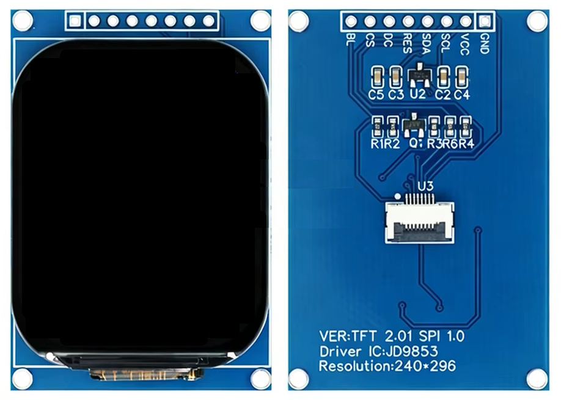
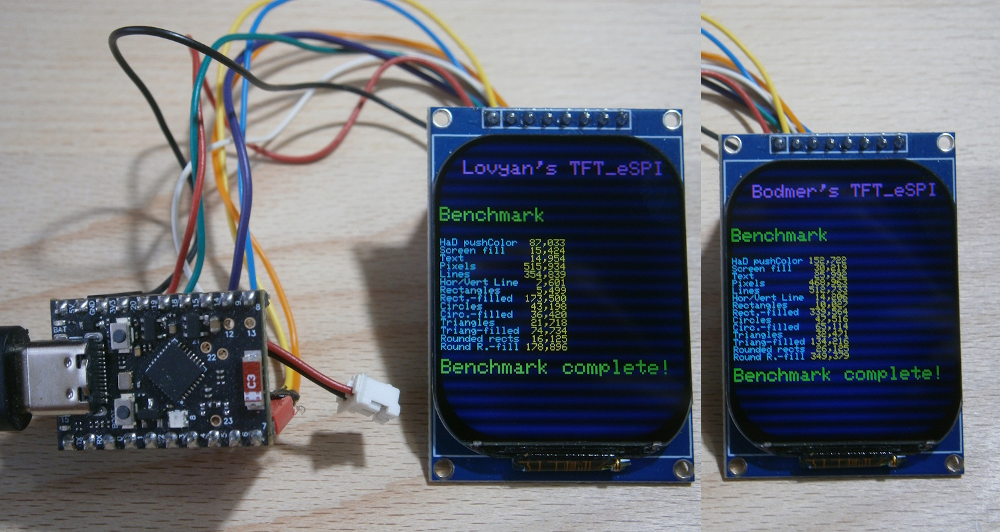
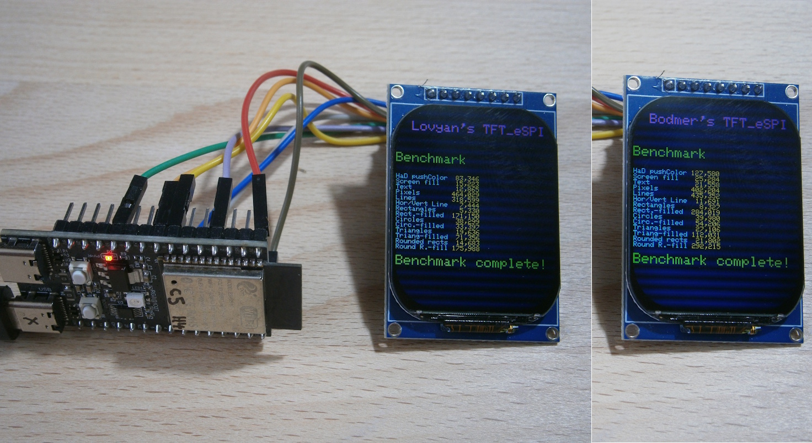
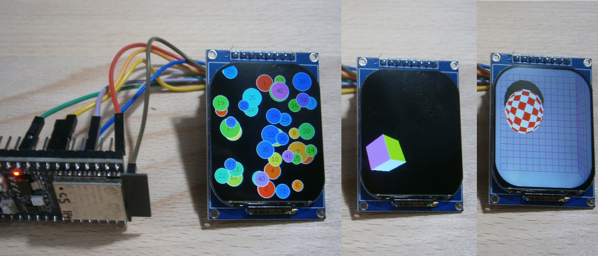

# Display JD9853 240x294 for TFT_eSPI and LovyanGFX 

Display JD9853 240x296

**Board Package :** esp32 3.3.12

**Arduino IDE Board :** MakerGO ESP32 C6 SuperMini or ESP32-C5 DevKit V2.0

**USB CDC On Boot :** Enabled

JD9853 240x296 with MakerGO ESP32 C6 SuperMini

JD9853 240x296 with ESP32-C5 DevKit V2.0

Some DMA Examples for TFT_eSPI

## Connections JD9853 for ESP32-C6 and ESP32-C5

| GPIO C6  | GPIO C5  | TFT   | Description          |
| -------: | -------: | :---- | :------------------- |
|       16 |       10 | CS    | CS                   |
|        5 |        5 | SDA   | MOSI                 |
|        6 |        6 | ---   | MISO  ( not used )   |
|        7 |        7 | SCL   | SCLK                 |
|        5 |        5 | DC    | DC                   |
|        4 |        4 | RST   | Reset                |
|        3 |        3 | BLK   | Backlight PWM pin    |
|          |          | VCC   | 3.3V                 |
|          |          | GND   | GND                  |

## Modifying TFT_eSPI and LovyanGFX

Copy or modify all files from the [Arduino/libraries/](Arduino/libraries/) directory, including its subdirectories. These are the only modified files of ( or added files to ) the original libraries TFT_eSPI and LovyanGFX, needed for the test programs.

## setRotation

Both libraries support rotations from 0 to 7. The rotations 4-7 work different in TFT_eSPI and LovyanGFX. See the pictures in the folder [pictures](pictures/)

## Test programs

These programs work with TFT_eSPI or LovyanGFX :

- [ESP32_C6_JD9853_240x296_Lovyan_graphicstest.ino](Arduino/ESP32_C6_JD9853_240x296_Lovyan_graphicstest/ESP32_C6_JD9853_240x296_Lovyan_graphicstest.ino)
- [ESP32_C5_JD9853_240x296_Lovyan_graphicstest.ino](Arduino/ESP32_C6_JD9853_240x296_Lovyan_graphicstest/ESP32_C6_JD9853_240x296_Lovyan_graphicstest.ino)

This programs work only with TFT_eSPI :

- [ESP32_C6_JD9853_240x296_TFT_eSPI_graphicstest.ino](Arduino/ESP32_C6_JD9853_240x296_TFT_eSPI_graphicstest/ESP32_C6_JD9853_240x296_TFT_eSPI_graphicstest.ino)
- [ESP32_C5_JD9853_240x296_TFT_eSPI_graphicstest.ino](Arduino/ESP32_C6_JD9853_240x296_TFT_eSPI_graphicstest/ESP32_C6_JD9853_240x296_TFT_eSPI_graphicstest.ino)

Some DMA examples for the ESP32-C5 :
- [ESP32_C5_JD9853_240x296_Bouncy_Circles_8.ino](Arduino/ESP32_C5_JD9853_240x296_Bouncy_Circles_8/ESP32_C5_JD9853_240x296_Bouncy_Circles_8.ino)
- [ESP32_C6_JD9853_240x296_SpriteRotatingCube.ino](Arduino/ESP32_C6_JD9853_240x296_SpriteRotatingCube/ESP32_C6_JD9853_240x296_SpriteRotatingCube.ino)
- [ESP32_C5_JD9853_240x296_boing_ball.ino](Arduino/ESP32_C5_JD9853_240x296_boing_ball/ESP32_C5_JD9853_240x296_boing_ball.ino)

