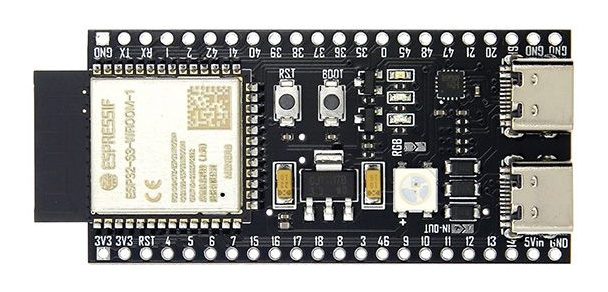
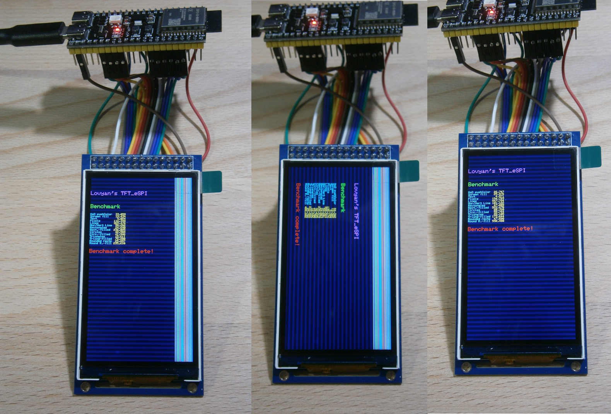

# Display ST7701 360x640 with LovyanGFX and ESP32-S3 N16R8


ESP32-S3 N16R8

**Board Package :** esp32 3.3.12

**Arduino IDE Board :** ESP32S3 Dev Module

**PSRAM :** OPI PSRAM


ST7701 rotation 0, rotation 1 and with workaround 480x640

## Connections for ST7701 ans ESP32-S3

Connections can be seen in the file [LGFX_ESP32_S3_ST7701_360x640.hpp](Arduino/ESP32_S3_ST7701_360x640_Lovyan_graphicstest/LGFX_ESP32_S3_ST7701_360x640.hpp) 

The display pin RST is connected to the ESP32-S3 pin RST.

## Modifying the LovyanGFX library

Copy or modify the files from the [Arduino/libraries/](Arduino/libraries/) directory, including its subdirectories. The files [Panel_RGB.hpp](Arduino/libraries/LovyanGFX/src/lgfx/v1/platforms/esp32s3/Panel_RGB.hpp) and [Panel_RGB.inl](Arduino/libraries/LovyanGFX/src/lgfx/v1/platforms/esp32s3/Panel_RGB.inl) are modified to implement a custom initialisation for this display.

Alternatively you can use "Panel_ST7701_guition_esp32_4848S040" for this display, if you comment line 327, which limits the display lines to 480 :
````
//0xC0,  2,	0x3B, 0x00,  // added by manufacture  // Display Line Setting = 480
````
"Panel_ST7701" works too for this display, but the colors are wrong, because the initialisation is for an IPS display.

## Offset problems

Ther are 120 pixel missing on left side and garbage 120 pixel on the right side of the screen. I guess "cfg.offset_x" in [LGFX_ESP32_S3_ST7701_360x640.hpp](Arduino/ESP32_S3_ST7701_360x640_Lovyan_graphicstest/LGFX_ESP32_S3_ST7701_360x640.hpp) should fix this, but it doesn't work.
````
cfg.offset_x = 120;
````
As a workaround and for verification i set "cfg.panel_width" to 480. The result can be seen on the right side of the picture. 

## Test program

- [ESP32_C6_JD9853_240x296_Lovyan_graphicstest.ino](Arduino/ESP32_S3_ST7701_360x640_Lovyan_graphicstest/ESP32_S3_ST7701_360x640_Lovyan_graphicstest.ino)

## Display initialisation

Found here and in the folder [documents](documents/) : 
- https://www.buydisplay.com/3-inch-360x640-ips-tft-lcd-display-spi-rgb-interface-st7701-controller 
- https://www.buydisplay.com/arduino/ER-TFT030-1_Arduino_Tutorial.zip 