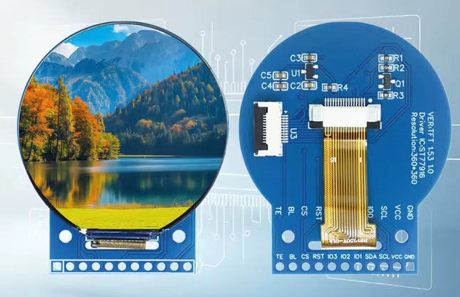
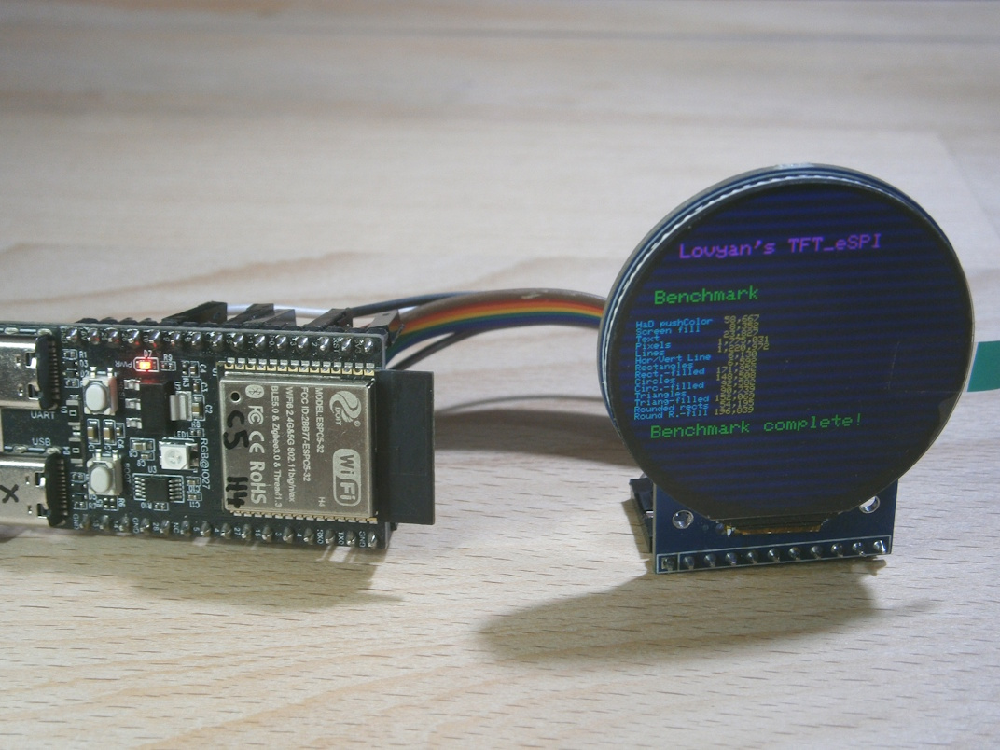
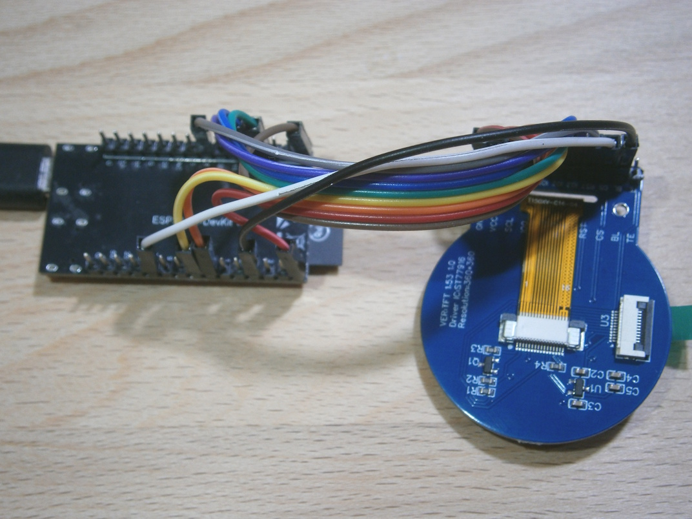

# QSPI display ST77916 360x360 and LovyanGFX 


1.5inch display ST77916 360x360

**Board Package :** esp32 3.3.12

**Arduino IDE Board :** ESP32-C5 DevKit V2.0

**USB CDC On Boot :** Enabled


ESP32-C5 and ST77916 360x360


ESP32-C5 and ST77916 360x360


## Connections ST77916 for ESP32-C5

| GPIO C5  | TFT   | Description          |
| -------: | :---- | :------------------- |
|       10 | CS    | CS                   |
|        7 | SDA   | MOSI                 |
|       24 | SDA   | MOSI                 |
|       23 | SDA   | MOSI                 |
|       15 | SDA   | MOSI                 |
|        2 | ----  | MISO  ( not used )   |
|        6 | SCL   | SCLK                 |
|        4 | RST   | Reset                |
|        3 | BL    | Backlight PWM pin    |
|          | VCC   | 3.3V                 |
|          | GND   | GND                  |

## Speed comparison and problems

Unlike TFT_eSPI LovyanGFX supports QSPI natively. The graphicstest works fine with LovyanGFX except for testHaD(), which doesn't show up. Advantages and disadvantages can be seen in the comparison with a JD9853 display (both at 80MHz SPI clock) :

````java
                         ST77916           JD9853 

Benchmark                   Time             Time (microseconds)
HaD pushColor              58694            82879
Screen fill                 8353            15225
Text                       23658            12919
Pixels                   1783496           441884
Lines                    1205450           318364
Horiz/Vert Lines            6121             7428
Rectangles (outline)        6596             5320
Rectangles (filled)       171936           171160
Circles (filled)           93203            33627
Circles (outline)         149401            38374
Triangles (outline)        91203            19350
Triangles (filled)        151521            71490
Rounded rects (outline)    54011            14710
Rounded rects (filled)    196483           175965
Done!
````

## Test programs

- [ESP32_C5_ST77916_360x360_Lovyan_graphicstest.ino](Arduino/ESP32_C5_ST77916_360x360_Lovyan_graphicstest/ESP32_C5_ST77916_360x360_Lovyan_graphicstest.ino)

- [ESP32_C5_ST77916_360x360_SpriteRotatingCube.ino](Arduino/ESP32_C5_ST77916_360x360_SpriteRotatingCube/ESP32_C5_ST77916_360x360_SpriteRotatingCube.ino) ( works really fast but with artefacts )

